# Eager preemptive refresh and errors

First: [Preemptive refresh and errors](../preemptive-refresh/README.md) | [Client configuration](../../README.md)

Eager refresh adds **one-shot scheduled triggers** to preemptive caching. After a token has been loaded, refresh can continue without application traffic or health polling. Ordinary requests still follow all the cache, concurrency, immediate-retry, and blocking-load rules in the first guide.

Eager refresh is disabled by default. With caching and preemptive refresh enabled, add this fragment beneath a generic, Auth0, or Keycloak client's configuration:

```yaml
cache:
  preemptive-refresh:
    enabled: true
    error-cooldown: 15
    eager:
      enabled: true
      error-cooldown: 60
```

Both cooldown values are in seconds. The builder equivalents are `preemptiveErrorCooldown(...)` and `eagerErrorCooldown(...)`; eager scheduling is enabled by `preemptiveCacheRefresh(timeout, unit, constraint, true)`. The independent `retry-after` configuration sits beside `cache`; by default HTTP failures establish a server-directed deadline or a 15-second fallback.

## 1. Startup: a first load is still required

Constructing an eager provider does not itself fetch a token or schedule its first refresh. A token request, a refreshing health check that reaches the cache, or Spring's startup listener can populate it.

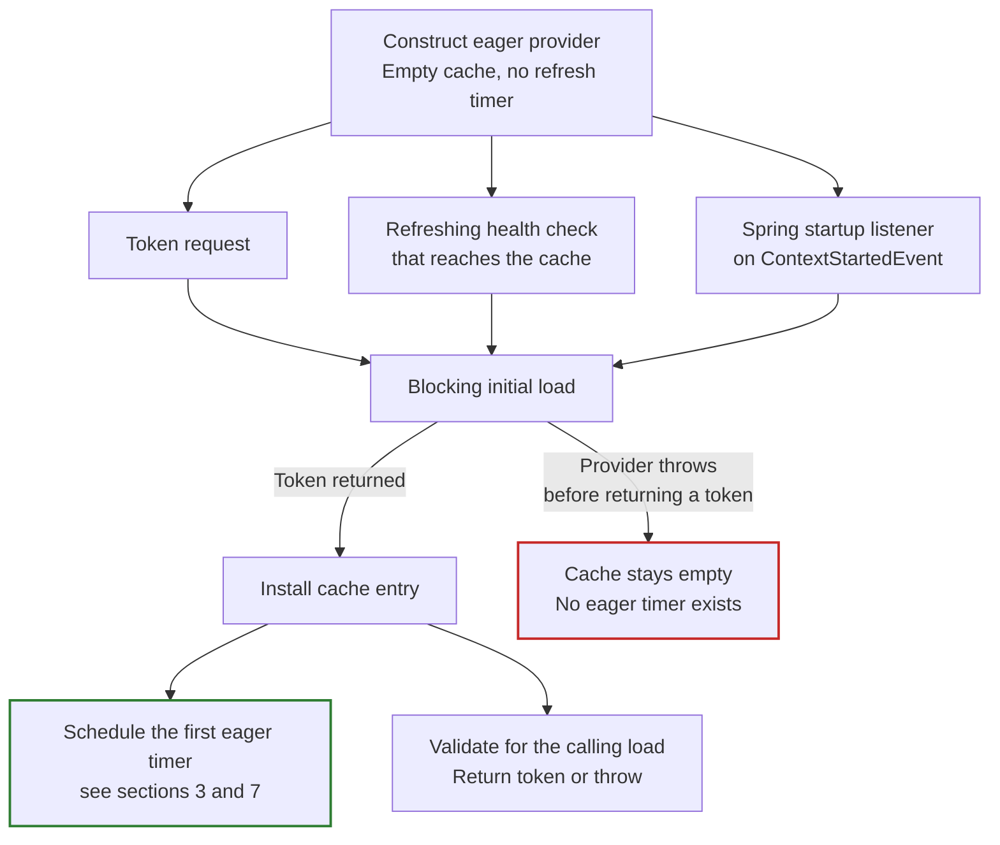

Spring's `EagerContextStartedListener` calls `getAccessToken(false)` on `ContextStartedEvent`. Publish that event explicitly, for example:

```java
SpringApplication.run(MyApplication.class, args).start();
```

A normal context refresh alone is not this event. The listener logs a failed warmup and continues with other clients. Currently it selects enabled clients with caching and preemptive refresh enabled, not only clients with the nested eager flag enabled; only eager-enabled providers establish a repeating refresh lifecycle.

If the first response is an unusable token rather than an exception before replacement, a cache entry exists and [invalid-entry scheduling](#7-invalid-replacements-and-foreground-loads) applies. Do not confuse that case with an empty cache after a cold-load exception.

## 2. Normal eager refresh without traffic

Using the first guide's definitions, the normal eager target is:

```text
eagerDueAt = refreshableAt - refreshTimeout
```

With the defaults and a token loaded at `12:00:00` that expires at `12:10:00`:

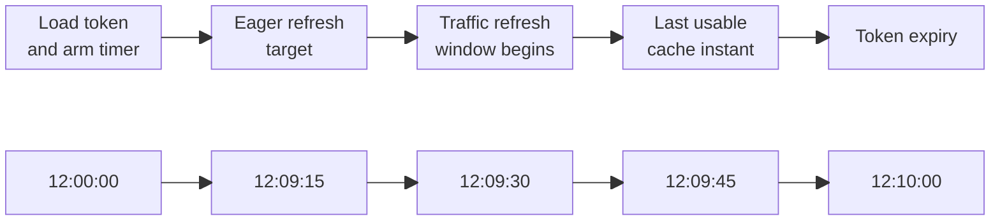

The lower row is a separate time axis aligned with the events above it; spacing is not to scale.

The eager target is 15 seconds earlier than the traffic refresh window because `refresh-timeout` is subtracted. The percentage constraint determines `refreshableAt`; it is not an additional lower bound on this earlier scheduled target.

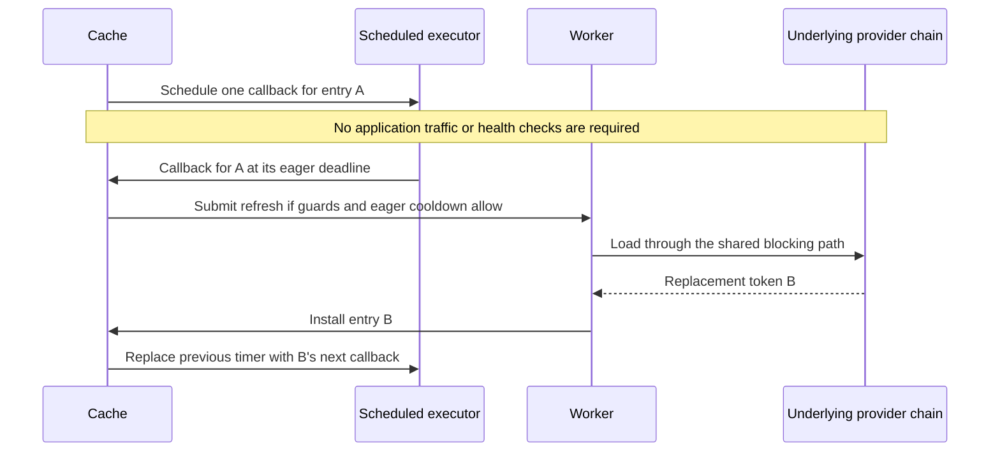

The scheduled callback uses an **internal force flag** to bypass the ordinary refresh-window check. It does not bypass closed-state checks, cache identity, in-flight deduplication, the dispatch lock, or the eager error cooldown, which includes any remembered Retry-After deadline. The HTTP provider also rejects an attempt without HTTP during a deadline the cache has not seen. It is different from public `getAccessToken(true)`, which takes the foreground blocking path without either background-error gate, but still obeys HTTP backoff.

A timer is a scheduling target, not a guarantee that HTTP work starts at that instant: a busy executor, lock contention, and an active cooldown can delay the actual load.

## 3. Choosing the next deadline after any replacement

Every token returned by the underlying provider creates a new cache entry. Whether the load was foreground or background, eager scheduling checks **the wall clock after fetching finishes**, before the calling reload performs its validity check.

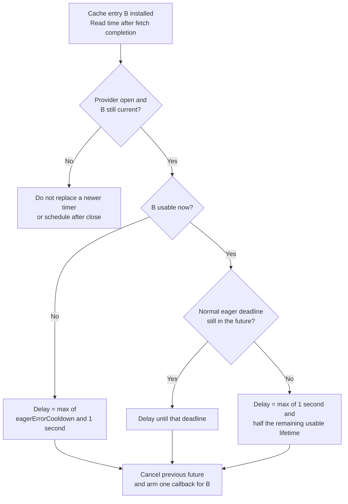

Normal positive delays are used as calculated. The one-second floor applies to error-recovery delays and overdue-valid-entry delays, not to every normally scheduled refresh.

Replacement validation still uses the time captured for the calling load. Scheduling deliberately uses the later, post-fetch time: a token that becomes unusable during a slow fetch can therefore take the unusable-entry scheduling branch even if the load-time validity check accepts it.

## 4. Failed refresh: automatic retry after one minute

A failed background attempt records one failure-completion timestamp, shared by both local gates. A callback deferred before dispatch is not a failed attempt and does not restart either gate. A Retry-After exception from an already-dispatched worker is handled as a failure: the cache remembers its deadline, and both gates then respect it together with the local cooldown.

| Next trigger | Default local gate since the latest background failure |
|--------------|-------------------------------------------------|
| Ordinary traffic, with a usable refreshable cache | 15 seconds (`preemptiveErrorCooldown`) |
| Scheduled eager callback | 60 seconds (`eagerErrorCooldown`) |
| Empty/unusable cache or public forced reload | Neither local gate applies; active HTTP backoff rejects the required load without HTTP |

The HTTP provider enforces its deadline `H` on all three paths. The cache remembers `H` from the failed attempt's `AccessTokenRetryAfterException`, so both background gates stay closed until `max(F + local cooldown, H)` and the scheduled retry is due at `D = max(F + 60 seconds, H)`, not the sum of both delays. The following assumes no other call replaces the cache or fails during the wait:

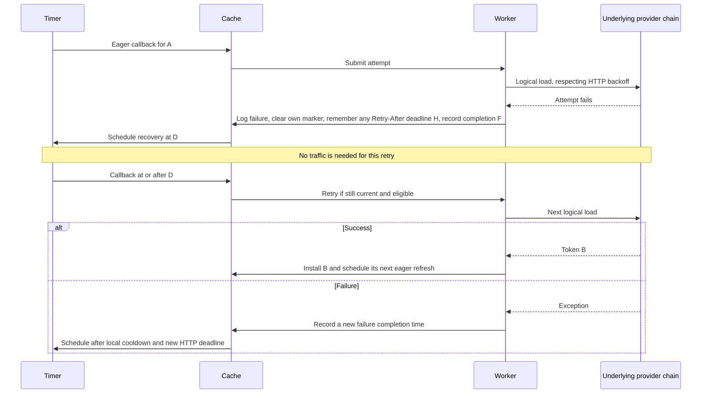

These are recurring attempts, not a maximum retry count or exponential backoff. If another thread already installed a usable replacement, the failed worker leaves that newer entry's schedule alone. If the failed load installed an unusable replacement, recovery targets that current entry instead of the obsolete one.

The retry delay starts after the complete failed attempt, including any immediate retry, finishes. A slow HTTP failure therefore adds its own duration before the 60-second wait begins.

Local cooldowns protect background attempts; **source backoff protects required HTTP loads too**. If the cache becomes unusable before `H`, callers fail without HTTP rather than receive an unusable token or sleep until recovery. After `H`, foreground loads may proceed without waiting for the eager timer's local cooldown. With no traffic, the timer still retries once its local cooldown and `H` permit, even if the cached token has become unusable.

## 5. Traffic during an eager cooldown, and early timers

The two local gates use independent durations, but the same latest background-failure timestamp. They are not independent failure histories. `H` below is the deadline remembered from the latest Retry-After failure, if any.

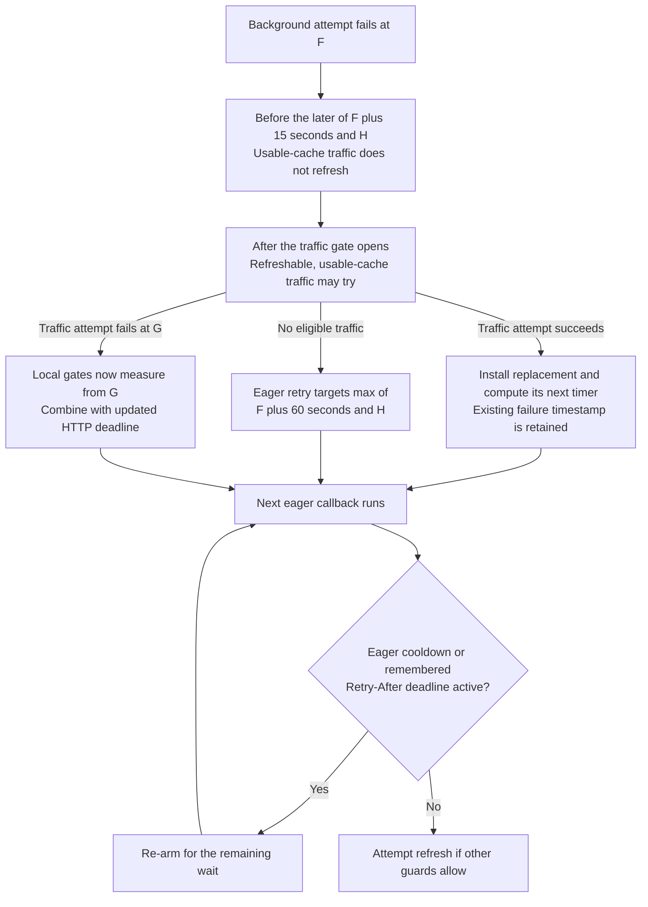

An early timer must not consume the only retry: it re-arms for the remainder of the later of the eager cooldown and `H`, without fetching or extending either. For example, with `Retry-After: 120`, a callback at 100 seconds has passed the 60-second eager cooldown but not `H`, so it re-arms for the remaining 20 seconds instead of reaching the HTTP provider. This also handles a successful replacement whose normal eager target falls inside an already-active cooldown. Success does not start a new error cooldown, but it does not clear the old one.

Custom durations can reverse the order: an eager cooldown shorter than the traffic cooldown allows scheduled work first, though a remembered `H` still gates both triggers. Setting either value to zero disables only that trigger's local gate. Eager error recovery retains a one-second floor even with a zero eager cooldown; a longer HTTP deadline still wins.

The [immediate retry wrapper](../preemptive-refresh/README.md#7-immediate-retry-is-separate-from-cache-cooldowns) always propagates Retry-After exceptions, even with zero or elapsed deadlines. The cache/scheduler handles the wait. With default cooldowns and negligible failure-processing time:

| HTTP failure delay | Earliest HTTP request from traffic-triggered refresh | Eager recovery target |
|--------------------|---------------------------------------------|-----------------------|
| Missing/malformed header: fallback 15 seconds | 15 seconds | 60 seconds |
| `Retry-After: 30` | 30 seconds | 60 seconds |
| `Retry-After: 120` | 120 seconds | 120 seconds |

If backoff was established by another load, the source rejects a dispatched worker before HTTP. The exception carries only the deadline. The worker's failure handler remembers that deadline, starts its local cooldown, and schedules recovery after the maximum of the remaining HTTP wait and the eager error cooldown. Early timer callbacks and traffic then wait for the remainder without extending either deadline.

## 6. Successful replacements that do not extend expiry

A replacement can contain the same token or an expiry equal to or earlier than the previous token. If it is still usable, it is a new cache entry and remains refreshable; expiry is not used as an in-flight fingerprint.

If its normal eager deadline is still in the future, that deadline is retained. If the callback runs at its actual calculated deadline and the replacement leaves the next deadline at or before completion time, scheduling **does not stop** and does not immediately spin:

```text
remainingUsableLifetime = usableUntil - timeAfterFetch
delay = max(1000 milliseconds, remainingUsableLifetime / 2)
```

For a token expiring at `12:10:00`, the default usable cache deadline is `12:09:45`. With negligible fetch duration, repeated same-expiry responses behave like this:

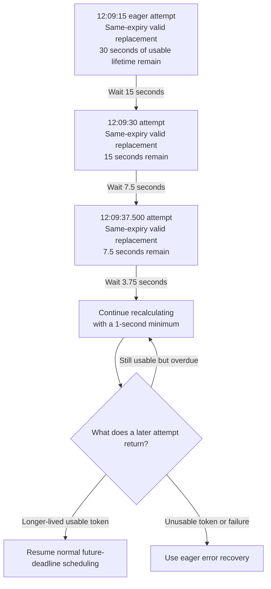

This is different from refreshing early. For example, a same-expiry replacement fetched at `12:09:00` can still use the normal future target at `12:09:15`. Running a timer early does not exercise the overdue-deadline branch.

An earlier expiry uses the same algorithm with less remaining usable lifetime. A response that fails minimum-lifetime validation is an error, not this valid-replacement case.

### Slow fetches and near-expiry tokens

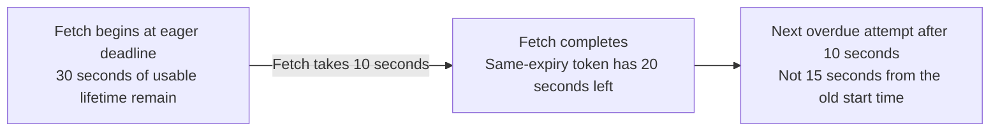

The remaining lifetime excludes `minimum-time-to-live`. A slow fetch must not add its duration back to the token's usable lifetime.

If only 1.5 seconds remain, half is 0.75 seconds and the one-second floor applies. If less than one second remains, the scheduled attempt can be **after usable cache expiry**. At exactly `usableUntil` the entry is still valid, so it also takes the one-second floor. When calculating a new schedule after a fetch, an entry already past that instant takes the eager error-recovery delay instead. An already-armed timer still attempts a refresh when it fires, even if its captured entry has since become unusable.

Existing error cooldowns may also postpone a callback beyond usable cache expiry. Neither this policy nor the percentage constraint guarantees uninterrupted availability. Successful overdue responses do not start an error cooldown and can lead to increasingly frequent attempts, bounded by the one-second floor for this branch.

## 7. Invalid replacements and foreground loads

The cache stores a provider response before validating it. An expired or insufficient-lifetime replacement can therefore overwrite a previously usable entry. Eager recovery must follow the **current** replacement, not the old token.

This diagram covers a replacement that is already unusable and fails the calling load's validity check:

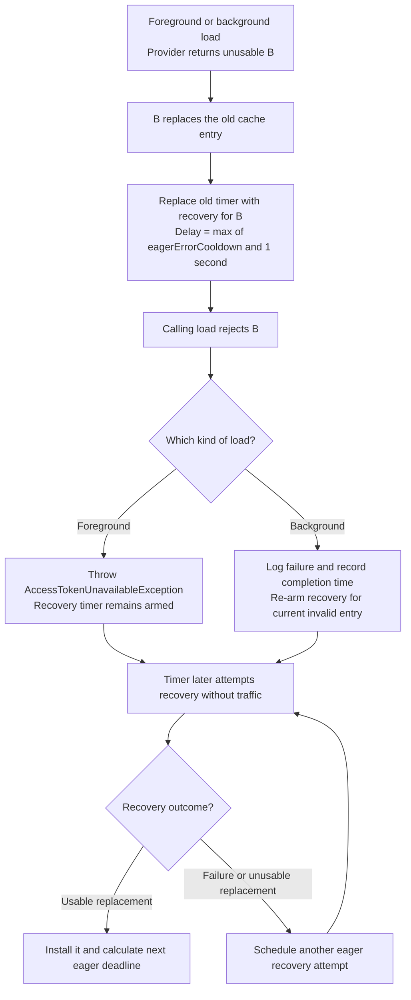

A foreground invalid replacement uses the eager recovery delay, but does not itself update the shared background-failure timestamp. Subsequent traffic sees unusable B and takes the blocking path without waiting for this timer. It does not fall back to the overwritten token.

Other foreground outcomes differ:

| Foreground outcome | Eager scheduling |
|--------------------|------------------|
| Provider throws before returning a replacement | Existing cache and timer are not replaced by that load; a cold empty cache still has no timer |
| Provider returns a usable replacement | Its normal or lifetime-aware timer replaces the old one |
| Lock wait times out or is interrupted | No replacement or new timer is created by that call |
| Another thread has already refreshed while this call waits | Reuse the other thread's cache entry and its established schedule |

## 8. Stale callbacks, concurrent refreshes, and health

Replacing an entry replaces its scheduled future. Cancellation can race with a callback that has already begun, so callbacks also check cache identity:

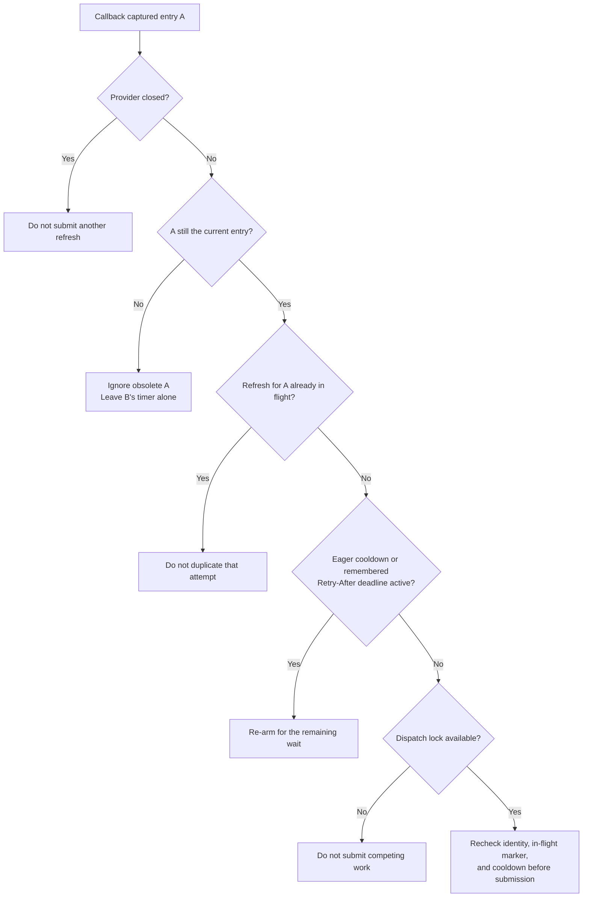

Inside the worker, the shared reload lock prevents concurrent provider loads. If a foreground reload wins the race and installs B, A's worker can reuse B. A failed old attempt cannot clear a newer attempt's marker or replace a newer usable entry's timer. A failure can, however, update the shared cooldown timestamp even when a newer usable entry already exists.

Eager refresh does not require health support. With health enabled, the eager health decorator's explicit `getHealth(true)` calls the top-level `getAccessToken(false)`, even after a previously successful result. That still means a cache hit, a traffic-gated preemptive attempt, or a blocking load according to cache state, not an unconditional forced refresh.

The Spring indicator first calls `getHealth(false)` and only requests refreshing checks for unhealthy providers, as shown in the [health diagram](../preemptive-refresh/README.md#8-health-checks-disabled-modes-and-lifecycle). Consequently, visiting a health endpoint is not the same as running every eager timer or resetting its cooldown. Healthy cached state can mask a failed refresh.

## 9. Shutdown

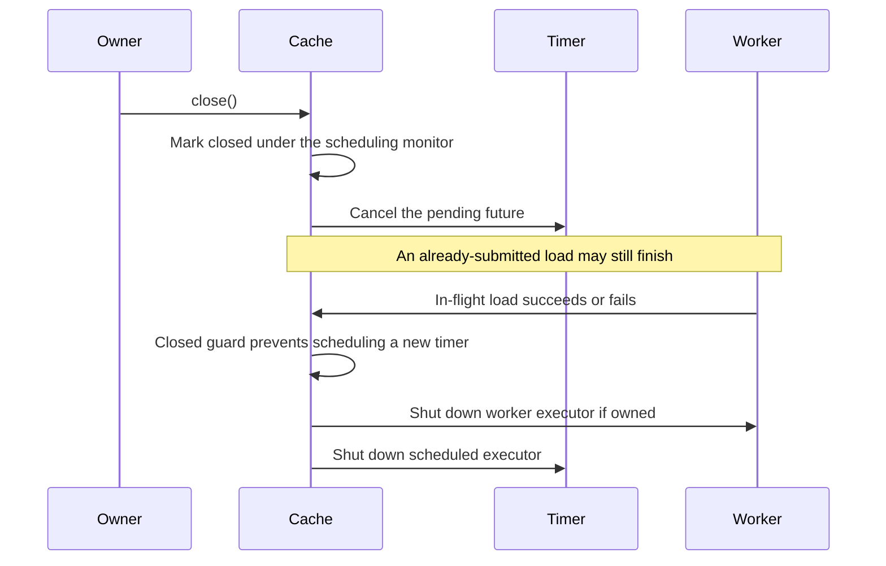

Scheduling and closing share the same monitor, so an in-flight completion cannot establish another eager timer after close. Closing also closes the underlying provider; a caller-supplied worker executor is shut down only when its ownership flag requests that. Do not use the provider after close or assume cancellation can stop every in-flight HTTP operation. This guide assumes that executors accept every submitted task, so an externally managed executor must remain available while the provider is in use.

## 10. Authorization-server load protection

The single scheduled callback, cache-entry identity checks, shared reload lock, and the builder-installed `ExclusiveAccessTokenProvider` prevent duplicate token loads for one provider. Failed HTTP requests establish a fixed server-directed delay or the default 15-second fallback; eager recovery additionally observes its local 60-second cooldown. Ordinary requests can keep using a valid token throughout that wait, but cannot bypass an active source deadline by forcing a reload.

Protection is per HTTP-provider instance, not per URL, JVM, or cluster. Reuse providers rather than creating one per request. Successful requests do not start backoff, including successful overdue replacements described in section 6; short normal deadlines, forced/uncached successes, explicit opt-out, and independent replicas are not globally rate-limited. See the first guide's [limits](../preemptive-refresh/README.md#9-authorization-server-load-protection-and-its-limits).

## Implementation references

See [PreemptiveCachedAccessTokenProvider](../../jwt-client-core/src/main/java/org/entur/jwt/client/PreemptiveCachedAccessTokenProvider.java), the [deadline, cooldown, replacement, and shutdown scenarios](../../jwt-client-core/src/test/java/org/entur/jwt/client/PreemptivceCachedAccessTokenProviderTest.java), [EagerContextStartedListener](../../jwt-client-spring-core/src/main/java/org/entur/jwt/client/spring/EagerContextStartedListener.java), and [EagerAccessTokenHealthProvider](../../jwt-client-core/src/main/java/org/entur/jwt/client/EagerAccessTokenHealthProvider.java).
