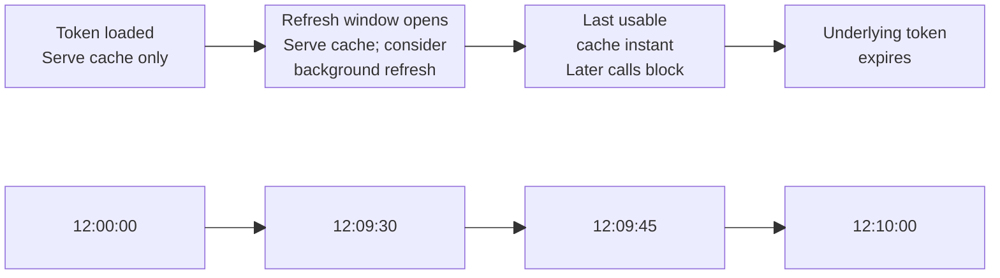
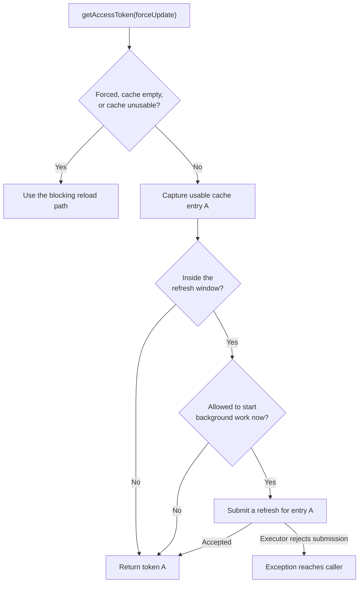
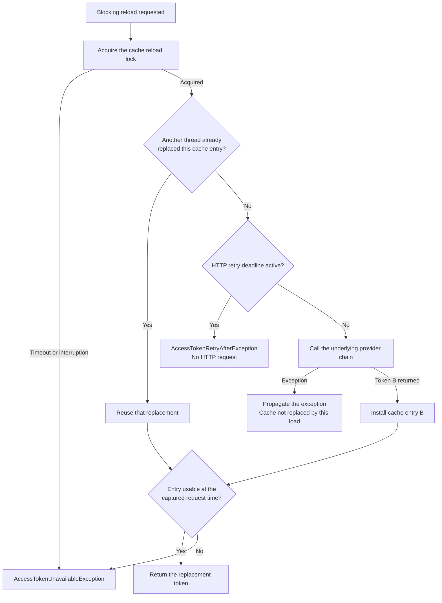
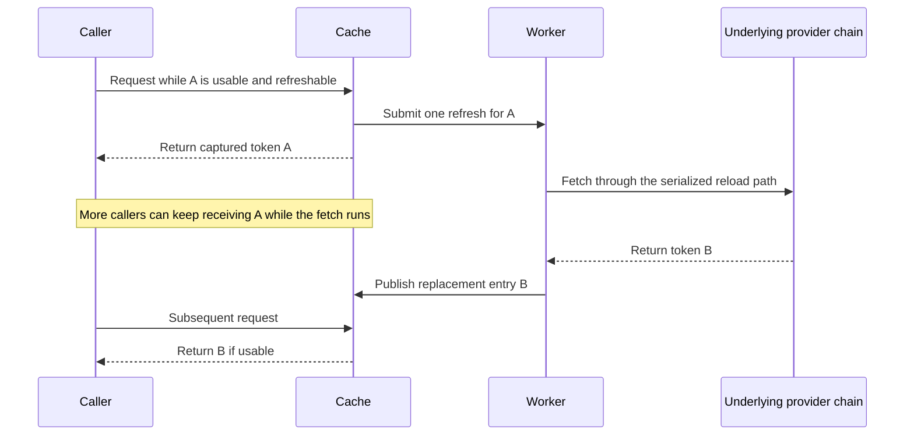
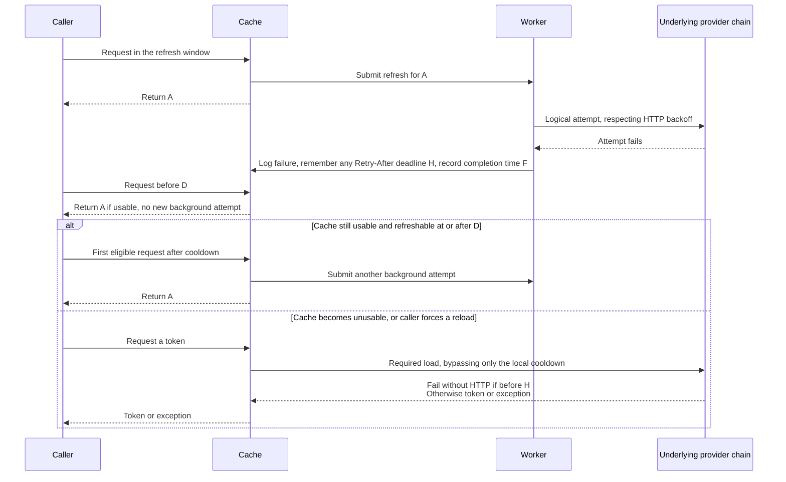
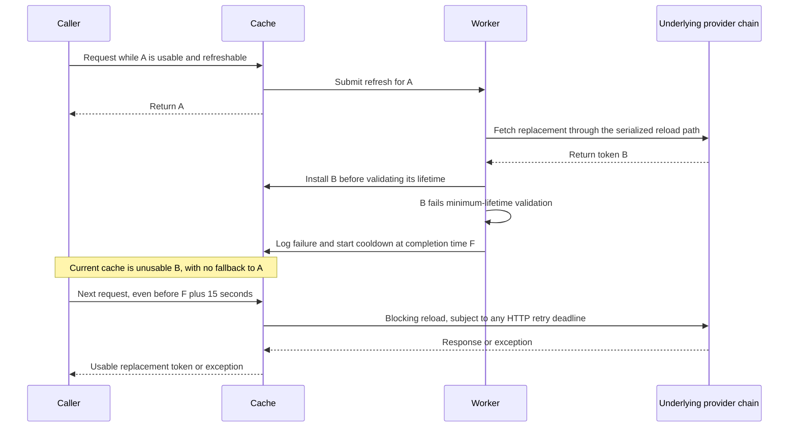
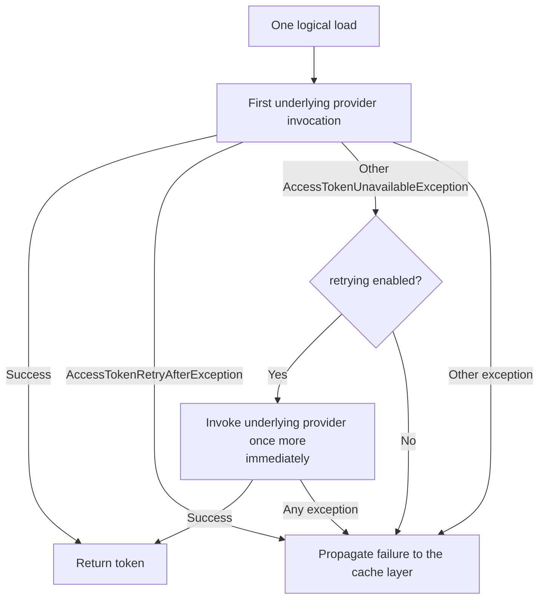
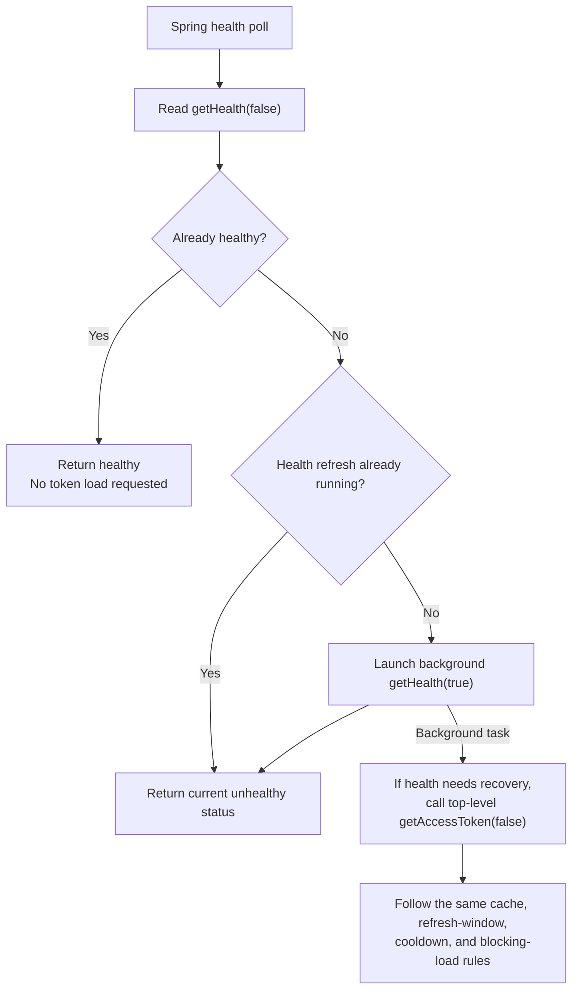

# Preemptive refresh and errors

[Client configuration](../../README.md) | Next: [Eager preemptive refresh and errors](../eager-preemptive-refresh/README.md)

This guide describes **traffic-triggered preemptive refresh**: caching and preemptive refresh enabled, eager refresh disabled. These are the defaults. The behavior is shared by generic, Auth0, and Keycloak clients using URLConnection, RestClient, WebClient, or the legacy RestTemplate transport.

A normal call is `getAccessToken(false)`. A usable cached token is returned without waiting for a background token fetch. An empty cache, an unusable token, or `getAccessToken(true)` takes the blocking path. This API is not nonblocking/reactive simply because the selected HTTP transport is WebClient.

## 1. Token lifetime and the refresh window

The following settings are relative to a client's `cache` configuration. Durations in Spring properties are in seconds.

| Setting | Default | Purpose |
|---------|---------|---------|
| `minimum-time-to-live` | 15 seconds | Stop serving a cached token before its actual expiry |
| `refresh-timeout` | 15 seconds | Maximum wait to acquire the cache reload lock, not an HTTP request timeout |
| `preemptive-refresh.time-to-expires` | 30 seconds | Desired refresh lead time before token expiry |
| `preemptive-refresh.expires-constraint` | 25% | Delay the refresh window until this fraction of the calculated lifetime has elapsed |
| `preemptive-refresh.error-cooldown` | 15 seconds | Minimum time after a failed background attempt before traffic may start another |

Provider construction rejects a refresh lead time smaller than `minimum-time-to-live` and rejects negative error cooldowns.

Let `E` be the expiry reported by the underlying provider (`AccessToken.getExpires()`), and `T` the time captured for the request or background trigger. For each new cache entry:

```text
usableUntil   = E - minimumTimeToLive
earliest      = T + (E - T) * expiresConstraint / 100
refreshableAt = min(max(E - timeToExpires, earliest), usableUntil)
```

The calculation uses milliseconds and integer arithmetic. The cache is usable at `time <= usableUntil`, and refreshable at `time >= refreshableAt`. The lifetime constraint is recalculated for every replacement; it is not based on the JWT's original issue time.

For a token loaded at `12:00:00` and expiring at `12:10:00`, the defaults give:



The lower row is a separate time axis aligned with the behavior above it; spacing is not to scale.

With a short lifetime or a long configured lead time, the percentage constraint pushes the refresh window later. If that would be later than usable cache expiry, the window is capped at `usableUntil`. This can leave almost no usable preemptive window; the configuration cannot create extra token lifetime.

## 2. Every incoming token request



Background work is skipped if the provider is closed, entry A has been replaced, A already has a refresh in flight, the local error cooldown is active, or the nonblocking dispatch lock cannot be acquired. Cache identity, the in-flight marker, and the cooldown are checked again after acquiring that lock. The cache does not read the HTTP provider's deadline. It remembers the deadline carried by the latest `AccessTokenRetryAfterException` of a failed background attempt and treats the later of that deadline and the local cooldown as its gate. A deadline it has not seen is enforced by the HTTP provider, which rejects the attempt without HTTP.

This dispatch lock is separate from the blocking reload lock. Ordinary callers using a usable cache do not wait for either lock to become available.

## 3. Empty, expired, and explicitly forced loads

This is also the reload path used by a background worker. The difference is who waits and who receives an error: the foreground caller, or the worker described in section 5.



A cold-load exception leaves the cache empty. A later caller can try again, but an active HTTP deadline rejects that load without HTTP. If one waiting caller successfully replaces the cache, other waiters reuse that replacement. Waiting does not guarantee that every caller succeeds. The HTTP gate is checked at the source even if a deadline appears after dispatch.

**Neither background-error cooldown delays this path, but HTTP backoff still applies.** Expired-cache and public forced loads fail without HTTP while the source deadline is active; they do not sleep until it expires. A failed forced load propagates its error rather than falling back to the old token. An exception before replacement leaves that old entry available to ordinary callers if it is still usable.

`getAccessToken(true)` forces the cache reload path, not necessarily a separate HTTP request: it can reuse another thread's replacement. The cache calls its delegate with `false`, so this is not a command to force a new authorization-server session instead of using a refresh token.

The reload lock is released after loading, before the usability check. Interruption restores the thread's interrupted status and produces `AccessTokenUnavailableException`. Configure HTTP connect/read timeouts separately; `refresh-timeout` does not cancel a slow HTTP request already holding the lock.

## 4. Successful background refresh and concurrent traffic



The triggering call returns the token it captured, even if the worker finishes very quickly. Background work can complete before or after that return; the caller does not wait for B.

Refresh coordination uses **cache-entry identity, not token expiry**:

| Concurrent situation | Behavior |
|----------------------|----------|
| More callers encounter A while its refresh is in flight | They return A without starting duplicate refreshes for A |
| A foreground load publishes B before A's worker acquires the reload lock | The worker reuses B rather than fetching again |
| A late trigger still refers to A after B is installed | The stale trigger is ignored |
| B has the same token value, the same expiry, or an earlier expiry than A | B is still a new cache entry; if usable, it can be refreshed when its own window is reached |

## 5. Background failure and the 15-second cooldown

An `Exception` thrown inside the worker's reload is logged. The failed attempt's in-flight marker is cleared without clearing a newer attempt's marker, and the failure completion time is recorded using a monotonic clock. This includes Retry-After exceptions, other provider errors, unchecked exceptions, lock failures, and failed replacement validation. Skipping work at the gate (the local cooldown or a remembered Retry-After deadline) does not start another background-error cooldown, but an attempt rejected by an HTTP deadline the cache had not seen is an ordinary failed attempt and does.

The diagram below assumes failure **before replacing A**, so the old usable cache remains. `H` is the deadline carried by a Retry-After failure, if any; the gate opens at `D = max(F + 15 seconds, H)`.



**The cooldown is a gate, not a timer.** With eager refresh disabled, no traffic means no background retry. The first eligible request after the cooldown starts another attempt; there is no automatic request exactly 15 seconds later. During a longer `Retry-After`, for example 120 seconds, the remembered deadline keeps the gate closed: no attempt is dispatched until 120 seconds have passed, not 15 or 135, and deferred requests do not restart the cooldown.

The cooldown starts when the entire failed background attempt finishes, not when it starts or when its first HTTP request fails. Each subsequent failed background attempt restarts it. A successful response does not record a new failure, but it does not clear an already-active failure timestamp either.

Setting `preemptive-refresh.error-cooldown: 0` removes only the local cooldown: a remembered Retry-After deadline still gates traffic, and the HTTP provider still rejects attempts during its deadline. It does not permit duplicate concurrent attempts for the same entry. A foreground HTTP failure starts source backoff, but does not itself start this background-error cooldown.

## 6. A replacement token is returned but rejected

A provider response is not the same thing as a usable cache entry. An expired token, or one with insufficient remaining lifetime at validation, can already have replaced the old cache before validation fails.



The original caller can already have received A, but subsequent callers do **not** automatically fall back to A: the current cache is B. A foreground load encountering the same validation failure throws `AccessTokenUnavailableException` directly.

An otherwise successful HTTP response does not establish source backoff merely because the cache rejects its remaining lifetime. The local background cooldown therefore does not prevent these foreground reloads.

Without eager refresh there is no recovery timer for B; another call is needed. With eager refresh, [invalid-replacement recovery](../eager-preemptive-refresh/README.md#7-invalid-replacements-and-foreground-loads) is scheduled as well.

## 7. Immediate retry is separate from cache cooldowns

The optional `retrying` wrapper is enabled by default and sits **below the cache**. The usual builder chain is cache, optional health decorator, optional retry wrapper, an `ExclusiveAccessTokenProvider` around each built-in HTTP provider, then the underlying token provider.



The wrapper **always rethrows `AccessTokenRetryAfterException` unchanged**. It does not inspect deadlines or decide when another attempt is allowed. This also applies to zero or already-elapsed deadlines: the current load fails, but a subsequent call can proceed as soon as the HTTP provider permits it.

Other `AccessTokenUnavailableException` failures get at most one immediate retry. With `retry-after.fallback-delay: 0`, HTTP failures without a usable `Retry-After` header use that ordinary path; a valid header still produces `AccessTokenRetryAfterException`. Only a failure escaping the wrapper reaches the cache's error handling.

Cache lock timeouts and cache validation errors occur above this wrapper, so it does not immediately retry them. Other provider exceptions are not retried by this wrapper, but a failed background load still gets the local cooldown behavior from section 5.

The built-in transports honor `Retry-After` on HTTP **429** and **503**, for both issuance and refresh. Nonnegative whole seconds and RFC-1123 HTTP-dates are supported. Without `Retry-After`, a future `X-RateLimit-Reset` (Auth0) or `X-Rate-Limit-Reset` (Okta) UNIX timestamp is converted to the equivalent delay; a timestamp which is not in the future is ignored. Dates and timestamps are converted once to a monotonic deadline, so later wall-clock changes do not move it. Missing, blank, or malformed headers, and other token-request failures, use the configurable **15-second fallback**. Valid shorter delays override that fallback; very large delays saturate at the representable timer limit. The rate limit headers present on the response, including Auth0's `Auth0-Client-Quota-Limit` and `Auth0-Organization-Quota-Limit`, are kept on the exception, for logging.

The deadline belongs to one HTTP-provider instance and is enforced there. Calls rejected during the wait do not extend it; a later failure can only extend it, never shorten it. Deadline updates keep the longest deadline atomically, so a late response cannot shorten it. A caller interrupted while waiting for a WebClient request cancels that request, so the `ExclusiveAccessTokenProvider` gate is not released while the request is still running. Issuance and refresh share the gate. A throttled refresh retains its session instead of immediately trying a new client-credentials grant. A genuinely rejected refresh token is discarded, with fresh issuance deferred until the fallback ends.

`AccessTokenRetryAfterException` carries the next-attempt deadline, without an attempted/deferred flag. The cache never reads the HTTP provider's deadline directly: a failed background attempt remembers the deadline from this exception, and both background gates, and eager recovery, wait for the maximum of it and the local cooldown. A background attempt dispatched before the cache has seen a deadline, for example one set by a foreground failure, is rejected by the provider without HTTP, and that exception is then remembered the same way. Foreground callers receive the exception directly.

## 8. Health checks, disabled modes, and lifecycle

The Spring health indicator first reads existing health without requesting a refresh:



The default health decorator requests a token when its last recorded provider result is absent or failed. A usable cached token can mask a failed background refresh as healthy, and a previously successful provider result can remain healthy without another remote call. Thus health polling is **not a guarantee of proactive refresh**. An explicit refreshing health check can warm an empty cache or recover a failed provider, but it is not an unconditional forced reload.

Disabling preemptive refresh leaves ordinary caching: usable entries are returned and empty, unusable, or forced loads use the reload path. Disabling caching removes the cache refresh mechanisms, **not HTTP backoff**. Health-triggered token loads use the same source gate.

On close, new preemptive work is skipped and an owned worker executor is shut down. An already-submitted task can still finish; callers must stop using a closed provider. An externally managed executor must remain available while the provider is in use. In particular, worker submission rejection happens outside the worker's failure handler: it can escape to a traffic caller and does not itself establish the token-fetch cooldown/recovery behavior above.

## 9. Authorization-server load protection and its limits

Caching shares a token across callers, identity-based coordination avoids duplicate refresh work, and the builder-installed `ExclusiveAccessTokenProvider` rejects concurrent token loads rather than queuing uncached fan-out. After a failed HTTP request, repeated traffic, forced reloads, health checks, and the retry wrapper cannot send another request before the fixed source deadline. Neither these rejections nor early timer callbacks restart the wait.

Use `retry-after.fallback-delay: 0` only to drop the client-chosen wait deliberately; valid server directives are still honored. These properties sit beside `cache`, not inside it.

This is failure backoff, **not a guarantee that a server can never be overloaded**. Reuse providers: independent instances and replicas do not share deadlines. Successful forced/uncached requests have no minimum interval, a successful HTTP response rejected by the cache does not start HTTP backoff, and a server can permit an immediate subsequent call with zero. Revocation, custom providers, and retries configured inside an HTTP client are outside this gate.

## Implementation references

See [PreemptiveCachedAccessTokenProvider](../../jwt-client-core/src/main/java/org/entur/jwt/client/PreemptiveCachedAccessTokenProvider.java), [DefaultCachedAccessTokenProvider](../../jwt-client-core/src/main/java/org/entur/jwt/client/DefaultCachedAccessTokenProvider.java), [RetryingAccessTokenProvider](../../jwt-client-core/src/main/java/org/entur/jwt/client/RetryingAccessTokenProvider.java), [HTTP deadline enforcement](../../jwt-client-core/src/main/java/org/entur/jwt/client/AbstractUrlAccessTokenProvider.java), and the [preemptive provider scenarios](../../jwt-client-core/src/test/java/org/entur/jwt/client/PreemptivceCachedAccessTokenProviderTest.java).

Continue with [eager preemptive refresh and errors](../eager-preemptive-refresh/README.md).
